<a href="https://alessandromarchese.github.io">
  <picture>
  <source media="(prefers-color-scheme: dark)" srcset="./assets/header-dark.svg"/>
  <source media="(prefers-color-scheme: light)" srcset="./assets/header-light.svg"/>
  
</picture>
</a>

<p align="center">
  <a href="https://alessandromarchese.github.io">
    
  </a>
</p>

<p align="center">
  <a href="https://alessandromarchese.github.io"></a>
  <a href="https://scholar.google.com/citations?user=jBQo8-wAAAAJ"></a>
  <a href="https://www.linkedin.com/in/alessandro--marchese/"></a>
  <a href="mailto:alessandro.marchese@vub.be"></a>
</p>

---

### 👽 About me

```python
class Alessandro:
    role        = "Joint PhD student @ VUB × UHasselt"
    previously  = ["Engineering @ KU Leuven", "Visiting researcher @ King's College London"]
    interests   = ["causal inference", "explainable AI", "treatment effects", "ML for healthcare"]
    currently   = "turning counterfactual explanations into causal supervision"
    open_to     = ["collaborations", "new ideas", "a good coffee chat ☕"]
```

### 🔬 Research

<a href="https://neurips.cc/virtual/2026/loc/sydney/poster/149123"><picture>
  <source media="(prefers-color-scheme: dark)" srcset="./assets/paper-recourse-dark.svg"/>
  <source media="(prefers-color-scheme: light)" srcset="./assets/paper-recourse-light.svg"/>
  
</picture></a>
<p align="right"><sub>📄 <a href="https://neurips.cc/virtual/2026/loc/sydney/poster/149123">Paper</a> &nbsp;·&nbsp; 💻 <a href="https://github.com/AlessandroMarchese/Recourse-CADR">Code</a></sub></p>

<a href="https://proceedings.neurips.cc/paper_files/paper/2025/file/fde7a53da2d95f459331e308e684c9a9-Paper-Conference.pdf"><picture>
  <source media="(prefers-color-scheme: dark)" srcset="./assets/paper-clexnet-dark.svg"/>
  <source media="(prefers-color-scheme: light)" srcset="./assets/paper-clexnet-light.svg"/>
  
</picture></a>
<p align="right"><sub>📄 <a href="https://proceedings.neurips.cc/paper_files/paper/2025/file/fde7a53da2d95f459331e308e684c9a9-Paper-Conference.pdf">Paper</a> &nbsp;·&nbsp; 💻 <a href="https://github.com/AlessandroMarchese/ClexNet">Code</a></sub></p>

<a href="https://raw.githubusercontent.com/mlresearch/v259/main/assets/marchese25a/marchese25a.pdf"><picture>
  <source media="(prefers-color-scheme: dark)" srcset="./assets/paper-dynamite-dark.svg"/>
  <source media="(prefers-color-scheme: light)" srcset="./assets/paper-dynamite-light.svg"/>
  
</picture></a>
<p align="right"><sub>📄 <a href="https://raw.githubusercontent.com/mlresearch/v259/main/assets/marchese25a/marchese25a.pdf">Paper</a> &nbsp;·&nbsp; 💻 <a href="https://github.com/AlessandroMarchese/DynamITE">Code</a></sub></p>

### 🧪 Other projects

| | Project | What it is |
|:-:|---|---|
| 🚚 | [**Decision-Focused Learning × Amazon Routing**](https://github.com/AlessandroMarchese/DecisionFocusedLearning-Amazon-Routing-Challenge-2023) | Decision-focused learning on the Amazon Last-Mile Routing Challenge (2023) |
| 🧬 | [**Genetic Algorithms for the TSP**](https://github.com/AlessandroMarchese/Genetic-Algos-TSP-annealing-2022) | Evolutionary search with simulated annealing for the travelling salesman problem (2022) |
| ❤️ | [**PU-learning for CVDs**](https://github.com/AlessandroMarchese/PU-learning-CVDs-2022) | Positive-unlabelled learning applied to cardiovascular disease data (2022) |
| 📚 | [**awesome-explanatory-supervision**](https://github.com/AlessandroMarchese/awesome-explanatory-supervision) | Curated list of resources on learning from explanatory supervision |

### 🛠️ Toolbox

<p align="center">
  <a href="https://skillicons.dev"></a>
</p>

### 🐍 Contributions

<picture>
  <source media="(prefers-color-scheme: dark)" srcset="https://raw.githubusercontent.com/AlessandroMarchese/AlessandroMarchese/output/github-snake-dark.svg"/>
  <source media="(prefers-color-scheme: light)" srcset="https://raw.githubusercontent.com/AlessandroMarchese/AlessandroMarchese/output/github-snake.svg"/>
  
</picture>

<p align="center"><sub>Thanks for visiting — I hope something here sparks curiosity or connection. 👽</sub></p>
